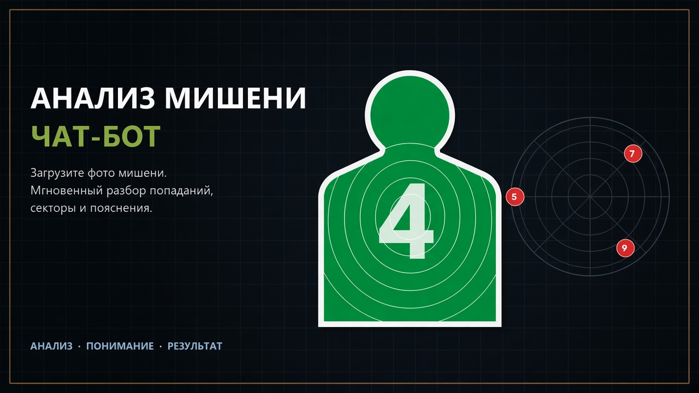
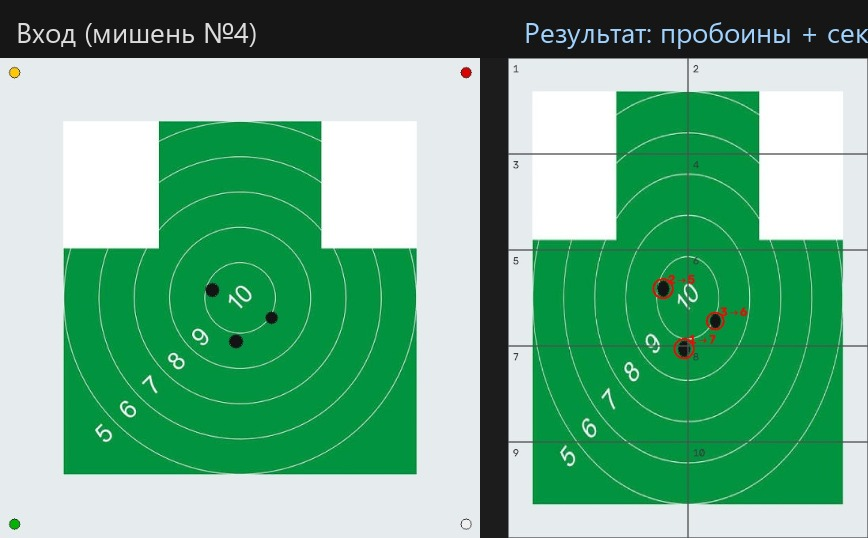
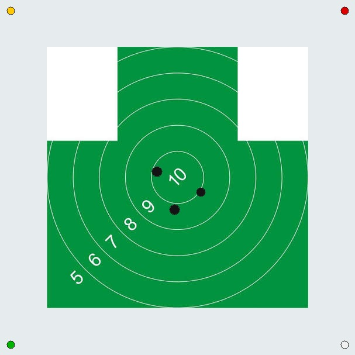
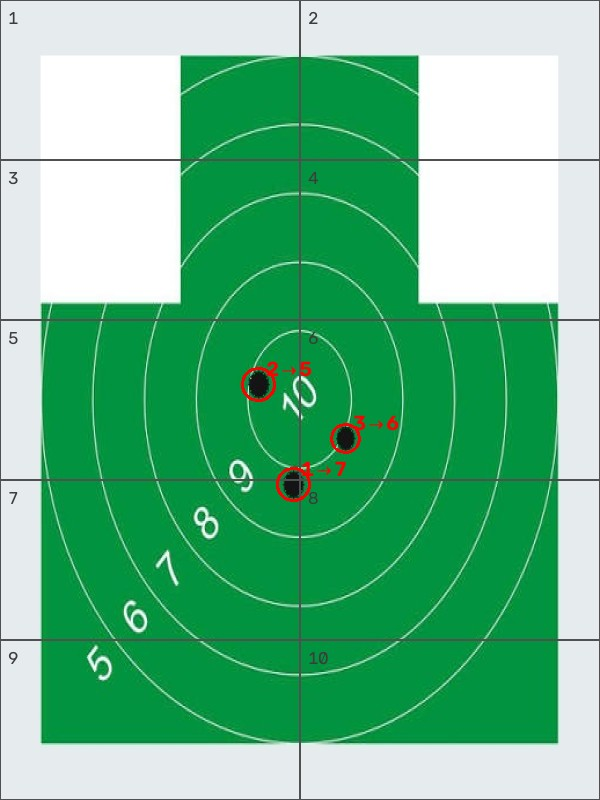
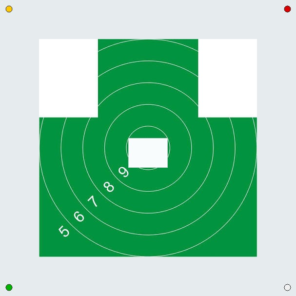
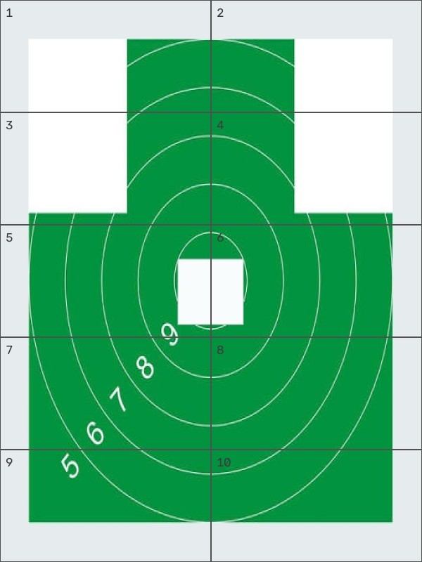

<p align="center">
  
</p>

<h1 align="center">УрЮИ МВД · Target Bot</h1>

<p align="center">
  Чат-бот в <b>MAX</b> для анализа грудной мишени №4:<br/>
  находит пробоины, определяет сектор попадания и отвечает на вопросы по правилам съёмки.
</p>

<p align="center">
  
  
  
  
</p>

---

## Что умеет бот

| | Функция | Результат |
|---:|---|---|
| 1 | **Анализ фото мишени** | Список пробоин + номер сектора (1–10) + размеченное изображение |
| 2 | **Фильтр скотча** | Пробития под белым малярным скотчем не учитываются |
| 3 | **Наложения** | Перекрывающиеся отверстия считаются одним попаданием |
| 4 | **Контроль лимита** | Предупреждение, если новых пробитий больше 4 |
| 5 | **FAQ / GigaChat** | Ответы на вопросы о съёмке и работе бота |

---

## Как это выглядит

<p align="center">
  
</p>

| Входное фото | Результат |
|:---:|:---:|
|  |  |

На результате: сетка секторов, номера пробоин и стрелка **пробитие → сектор**.

<details>
<summary>Пример: пробитие под белым скотчем исключается</summary>

| С скотчем | После фильтра |
|:---:|:---:|
|  |  |

</details>

---

## Сценарий в MAX

```text
Пользователь                Бот (MAX)
     │                         │
     │  «Анализ мишени»        │
     │────────────────────────►│
     │  фото мишени №4         │
     │────────────────────────►│
     │                         │── CV: выравнивание → отверстия
     │                         │      → скотч/крепёж → сектора
     │  overlay + отчёт        │
     │◄────────────────────────│
     │  «Как снимать?»         │
     │────────────────────────►│
     │  FAQ / GigaChat         │
     │◄────────────────────────│
```

Отчёт в чате выглядит так:

```text
Результат анализа мишени №4

Учтено пробитий: 3

Пробития:
1. сектор 3  (x=…, y=…)
2. сектор 6  (x=…, y=…)
3. сектор 9  (x=…, y=…)
```

---

## Архитектура (кратко)

```text
MAX Messenger  ──►  Bot (Python)
                      ├─ Dialog FSM + кнопки
                      ├─ Image Pipeline (OpenCV)
                      │    preflight → align → holes → tape → sectors → overlay
                      ├─ FAQ  ──►  GigaChat (опционально)
                      └─ Storage (фото, JSON, SQLite)
```

---

## Быстрый старт

```bash
python -m venv .venv

# Windows
.venv\Scripts\activate
pip install -r requirements.txt
copy .env.example .env

# В .env укажите токен с business.max.ru → Чат-боты
python -m app.main --mode polling
```

| Режим | Команда | Когда |
|---|---|---|
| Long polling | `python -m app.main --mode polling` | разработка |
| Webhook | `python -m app.main --mode webhook` | прод (`POST /max/webhook`) |

Healthcheck: `GET /health` → `{"status":"ok"}`

### Важные переменные

| Переменная | Назначение |
|---|---|
| `MAX_BOT_TOKEN` | токен бота MAX |
| `MAX_ROOT_CA_PATH` | CA Минцифры для `platform-api2.max.ru` |
| `GIGACHAT_ENABLED` | `true` / `false` (по умолчанию выкл.) |
| `OVER_LIMIT_POLICY` | `warn` или `reject` при >4 пробоинах |

Без ключа GigaChat анализ мишени и FAQ работают как обычно.

---

## Правила съёмки (по ТЗ)

- только **грудная мишень №4** (круги + зелёная заливка)
- мишень **целиком** в кадре, расстояние примерно **до 1 м**
- не более **4 новых** (незаклеенных) пробитий
- повторные — только **белый малярный скотч**
- крепёж — только в **углах** белого поля

---

## Структура репозитория

```text
app/
  max_bot/     # клиент MAX, FSM, webhook/polling
  cv/          # детекция пробоин и секторов
  llm/         # FAQ + GigaChat
  storage/     # фото, результаты, SQLite
assets/        # sector_map.json
docs/demo/     # демо-кадры для README
deploy/        # Dockerfile + CA Минцифры
tests/         # pytest
```

```bash
pytest -q
```

---

## Статус

Прототип НИР для **УрЮИ МВД РФ (Екатеринбург)**.  
Канал доставки — **MAX** (вместо Telegram из исходного ТЗ).  
Карта 10 секторов сейчас *provisional* (`assets/sector_map.json`) и уточняется с заказчиком.

<p align="center">
  <sub>Made for training / admissions lab workflows · OpenCV · MAX Bot API · GigaChat</sub>
</p>
